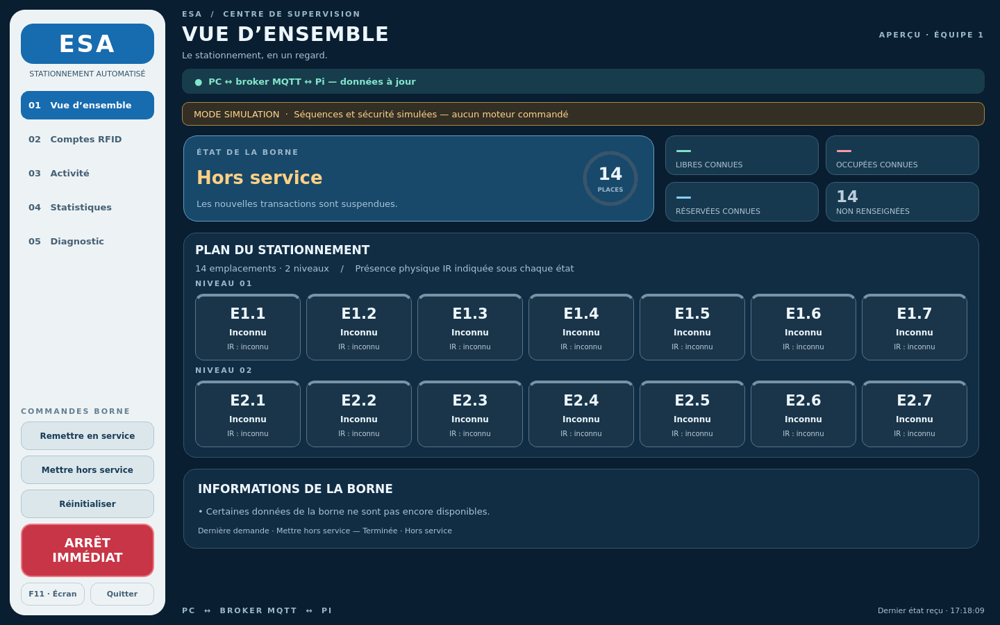
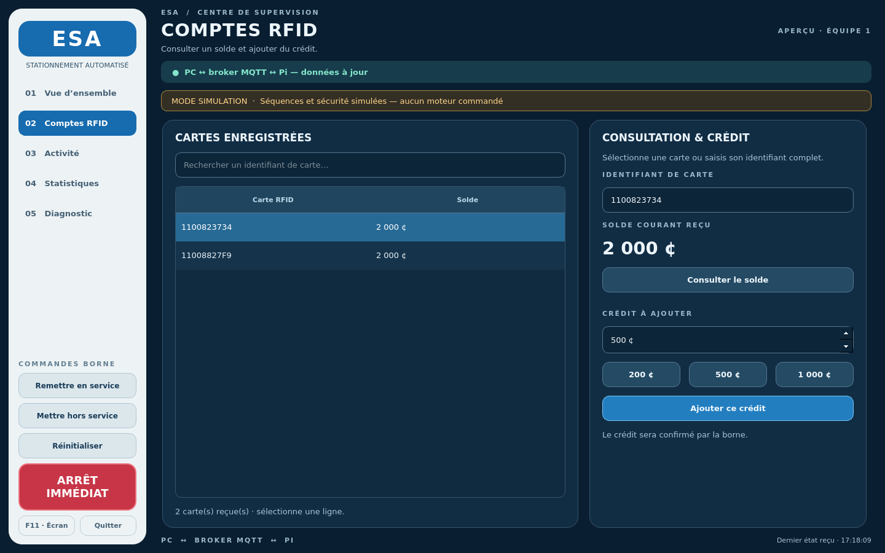

# Console PC ESA — T13

La console remplace l'écran de diagnostic unique par cinq pages opérateur.
Elle démarre **en plein écran, sans barre de titre native**. Les commandes
passent toujours par **PC ↔ broker MQTT ↔ Raspberry Pi**.

## Lancement

Sur le **PC**, avec l'environnement Python déjà utilisé pour les essais :

```bash
cd ~/Projects/Projet-session-5 &&
ESA_MQTT_HOTE=10.50.86.13 \
ESA_MQTT_PORT=1883 \
ESA_MQTT_PREFIXE=esa/Equipe_1 \
ESA_MQTT_TLS=0 \
"$HOME/.venvs/esa-t13/bin/python" -B prog/pc/main.py \
  --journal "$HOME/.local/share/esa/t13-service-sim-pc.sqlite3"
```

Conserver le même journal PC pour retrouver les demandes et leurs identifiants.
Cette évolution graphique ne nécessite aucun changement du serveur Pi testé
au commit `797fda3`.

| Commande locale | Effet |
| --- | --- |
| F11 ou bouton « F11 · Écran » | Alterner plein écran / fenêtre avec barre de titre |
| « Quitter » ou Ctrl+Q | Fermer proprement le client MQTT et son travailleur Qt |
| Option `--fenetre` au lancement | Démarrer directement en fenêtre |

## Pages

| Page | Informations et actions |
| --- | --- |
| Vue d'ensemble | État de service, 14 places réparties en deux niveaux, présence IR distincte de l'état logique, anomalies et dernière demande |
| Comptes RFID | Filtre par identifiant, sélection d'une carte, solde reçu, consultation et crédit en centimes entiers |
| Activité | Demandes PC, résultat en cours ou final, détail de la référence, renvoi avec le même ID ; onglet transactions de la borne |
| Statistiques | État d'attente explicite, puis informations réellement transmises par la borne |
| Diagnostic | Configuration du broker, disponibilités et instantané technique reçu en lecture seule |

Les quatre commandes de service restent accessibles dans la colonne gauche.
Le Pi vérifie leurs conditions, y compris les refus de réarmement et de remise
en service. L'arrêt logiciel conserve son bouton rouge sur toutes les pages.

Une place sans information reste **Inconnu** ; elle n'est jamais comptée libre.
Le libellé opérateur « Entretien » correspond à l'état logique `maintenance`.
La présence physique IR ne modifie pas l'état logique affiché.

Un instantané périmé est identifié comme dernier état connu ; les couleurs des
places deviennent neutres. Les données et le journal restent consultables,
mais les envois sont désactivés jusqu'à la resynchronisation. Le bandeau
distingue la perte du broker et l'attente du Pi avec broker encore connecté.

Le crédit nécessite exactement dix caractères hexadécimaux. Un identifiant
trop long n'est pas tronqué en identifiant valide. Dès le clic, une protection
locale bloque un second crédit pendant le passage vers le journal du
travailleur. Les protections durables et l'idempotence restent dans le client
et le Pi. Une acceptation s'affiche « En cours », jamais « Terminée ».

## Rendu

Direction visuelle inspirée des consoles de l'Axiom dans WALL‑E : navigation
claire et arrondie, panneaux bleu profond, typographie forte et couleurs
fonctionnelles. Le thème et les formes sont dessinés par Qt, sans image externe
nécessaire au lancement.

Captures du vrai code Qt avec des **états de test hors réseau**. Ces états ne
sont pas injectés dans l'application normale.





Le rendu a été inspecté à 1440×900, 1280×720 et 1024×768. Sur les petits écrans,
le contenu des pages défile ; les commandes de service et de fermeture restent
fixes. Les deux rangées de places sont visibles à 1280×720 avec le bandeau de
simulation dans l'état hors service.

## Validation et limites

Au 25 novembre 2026 : **212 tests réussis, aucun ignoré**, avec Qt hors écran et
Mosquitto local. La suite couvre notamment le vrai parcours de crédit MQTT,
le renvoi sans double crédit, les coupures/reconnexions et les commandes de
service simulées. Les nouveaux essais de console vérifient aussi le plein
écran au lancement, F11, Quitter, la saisie RFID, le double clic, la sélection
conservée, les états inconnus et les pages sans données.

```bash
ESA_TEST_BROKER=1 QT_QPA_PLATFORM=offscreen \
"$HOME/.venvs/esa-t13/bin/python" -B -m unittest discover \
  -s prog/tests -p 'test_*.py' -v
```

Mosquitto doit être installé pour cette suite ; `ESA_TEST_MOSQUITTO` peut
indiquer son chemin. Les tests utilisent un broker et des journaux temporaires.
Le mode Qt hors écran vérifie le lancement plein écran et les interactions,
mais le rendu du gestionnaire de fenêtres du PC reste à constater au lancement.

La campagne manuelle précédente a déjà validé les échanges PC/broker/Pi sur
`797fda3`, dont la fin locale d'une transaction pendant une coupure MQTT et la
réception du résultat après reconnexion. Les nouveaux visuels n'ont pas encore
été essayés sur le PC physique.

Les modules réels fournissant les places, transactions et statistiques ne sont
pas raccordés par cette modification. Leurs données absentes restent indiquées
comme indisponibles. Les futurs champs de transactions et statistiques sont
présentés en lecture seule sans inventer leur schéma ni des indicateurs.
Le mode simulation de service reste explicitement signalé. T13 complet reste
à intégrer et valider avec ces modules.

## Sources et code

- [Interface individuelle T13 fournie, section 12](https://chatgpt.com/library?file_id=libfile_fde3_f-09ca40cfe678819181e979db60e74858_cbe6ad3528f08191af91018d1e714e05&account_id=personal).
- [Contrat MQTT du dépôt](../commun/t13/CONTRAT_MQTT_PROPOSE.md).
- [Campagne de service simulé](ESSAIS_SERVICE_T13.md).
- [Direction graphique originale de WALL‑E, Mark Cordell Holmes](https://www.markcordellholmes.com/visual-storytelling).
- [Fenêtre](fenetre.py), [thème et présentation](visuels.py), [pont Qt](interface.py), [lancement](main.py).
- [Essais de console](../tests/test_console_pc_t13.py), [sélection et reprise](../tests/test_interface_pc_t13.py), [broker réel](../tests/test_t13_broker.py).
